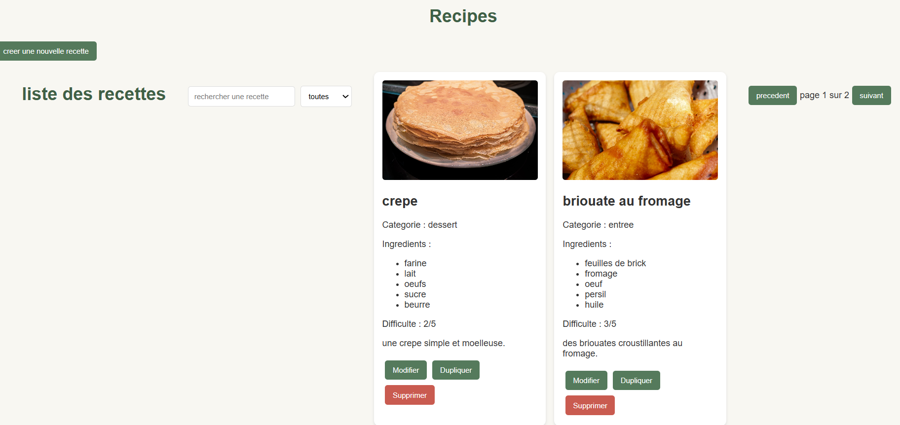
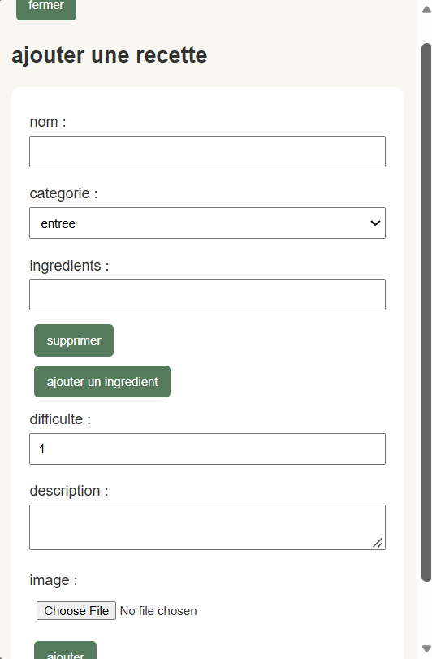

# Recipes

## About the Project

Recipes is a React application for displaying and managing recipes. Each recipe contains an image, a name, a category, a list of ingredients, a difficulty level, and a description.

## Screenshots

### Main Page

The main page displays the list of recipes with a search field, a category filter, pagination, and buttons to manage each recipe.

### Add a Recipe

The application includes a form for adding a recipe, with fields for the name, category, ingredients, difficulty, description, and image.

## Features

- Display recipes as cards
- Search for a recipe
- Filter recipes by category
- Navigate between pages
- Display a form to add a recipe
- Provide Modify, Duplicate, and Delete buttons for recipes

## Technologies Used

- React
- JavaScript
- HTML
- CSS

## How to Run the Project

1. Clone this repository.
2. Open the project folder in a terminal.
3. Install the dependencies:

   `npm install`

4. Start the application:

   `npm start`

5. Open http://localhost:3000 in your browser.
